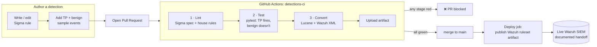

# detection-as-code

**Detection rules managed like production software: version-controlled, unit-tested, linted against the Sigma spec, and auto-compiled to a SIEM ruleset by CI. A pull request that adds a broken rule fails the pipeline and cannot be merged.**

This repo takes the Sigma detections I wrote in my [detection-engineering](https://github.com/manlikefelo/detection-engineering) project and puts them under a software-engineering pipeline — the same testing and CI discipline I used for years as a QA/SDET, applied to detection content instead of application code. That seam, *security work with test-automation rigor behind it*, is the whole point of this repo.

> **Problem:** most detection rules live as copy-pasted YAML with no tests, no review gate, and no history — so nobody can prove a rule still fires, or that a change didn't silently break it.
> **Approach:** treat every rule as code — a test pair per rule, a lint gate, a convert-to-SIEM step, and a CI pipeline that blocks bad rules on PR.
> **Result:** **5 rules, 100% under test, 6 ATT&CK techniques across 3 tactics, 25 sample assertions** — every one enforced on every pull request.

---

## Pipeline architecture



Three gates run on every PR that touches a rule, its tests, or the tooling:

| Stage | Tool | Fails the build when… |
|-------|------|-----------------------|
| **Lint** | `pySigma` + `tools/lint_rules.py` | a rule doesn't parse against the Sigma spec, is missing required fields / an ATT&CK tag, or has no samples file |
| **Test** | `pytest` + `tools/sigma_matcher.py` | a true-positive sample fails to fire, a benign sample fires, or a rule ships **without tests** |
| **Convert** | `pySigma` (Lucene) + `tools/convert_rules.py` (Wazuh) | a rule can't be compiled to the target backends |

On merge to `main`, a **deploy** job re-compiles and publishes the Wazuh ruleset as an artifact — the documented handoff point to a live SIEM (see [docs/ci-design.md](docs/ci-design.md)).

## Coverage

| Metric | Value |
|--------|-------|
| Rules in the repo | **5** |
| Rules with a test pair | **5 / 5 (100%)** |
| ATT&CK techniques covered | **6** — T1558.003, T1558.004, T1003.006, T1087.002, T1069.002, T1190 |
| ATT&CK tactics | **3** — Credential Access, Discovery, Initial Access |
| Sample assertions enforced in CI | **25** (10 true-positive · 15 benign) |

| Rule | Tactic | ATT&CK | Type |
|------|--------|--------|------|
| `kerberoasting_rc4_tgs` | Credential Access | T1558.003 | single-event |
| `asrep_roasting_no_preauth` | Credential Access | T1558.004 | single-event |
| `dcsync_replication_rights` | Credential Access | T1003.006 | single-event |
| `bloodhound_directory_read_burst` | Discovery | T1087.002 / T1069.002 | correlation (count) |
| `web_sqli_xss` | Initial Access | T1190 | single-event |

## Repo layout

```
rules/                 Sigma rules, organised by ATT&CK tactic
  credential-access/
  discovery/
  initial-access/
tests/                 one <rule>.yml of TP + benign sample events per rule
  test_detections.py   the pytest gate
tools/
  sigma_matcher.py     offline Sigma evaluator (no live SIEM needed)
  rule_loader.py       rule + sample discovery
  lint_rules.py        Sigma-spec + house-rule lint stage
  convert_rules.py     compile rules -> Lucene queries + Wazuh XML
.github/workflows/
  detections-ci.yml    lint -> test -> convert -> (deploy on main)
docs/                  ci-design.md, reviewer-path.md
```

## Run it locally

```bash
pip install -r requirements.txt

python tools/lint_rules.py     # stage 1
python -m pytest -v            # stage 2
python tools/convert_rules.py  # stage 3 -> build/converted/
```

## Showcase

- **A PR blocked by a failing detection test** — the single image that says "I understand quality gates." See [`screenshots/`](screenshots/) and the reproducible demo in [`examples/broken-rule-demo/`](examples/broken-rule-demo/).
- **A green pipeline** turning five Sigma rules into a deployable Wazuh ruleset on merge.
- **The test pair for one rule** — a true-positive event that *must* alert next to a benign event that *must not*, e.g. an RC4 Kerberoast ticket vs. the same ticket for a machine account (`WS01$`) that the rule correctly excludes.

_Screenshots to add: `screenshots/green-pipeline.png`, `screenshots/blocked-pr.png`, `screenshots/one-test-pair.png`._

## How this fits the rest of the portfolio

- Rules originate in **[detection-engineering](https://github.com/manlikefelo/detection-engineering)** (P2) — this repo version-controls and CI-tests them.
- The attacks they detect were run in **[ad-attack-chain](https://github.com/manlikefelo/ad-attack-chain)** (P1) and **[webapp-pentest-juiceshop](https://github.com/manlikefelo/webapp-pentest-juiceshop)** (P3).
- Part of the advanced portfolio round; see the pinned **[cybersecurity-portfolio](https://github.com/manlikefelo/cybersecurity-portfolio)** meta-repo.

**New to the repo?** Start with [docs/reviewer-path.md](docs/reviewer-path.md) — a 3-minute guided tour.

## Constraints

100% free/open source: GitHub Actions free tier, pySigma / sigma-cli, pytest. No secrets in git.
